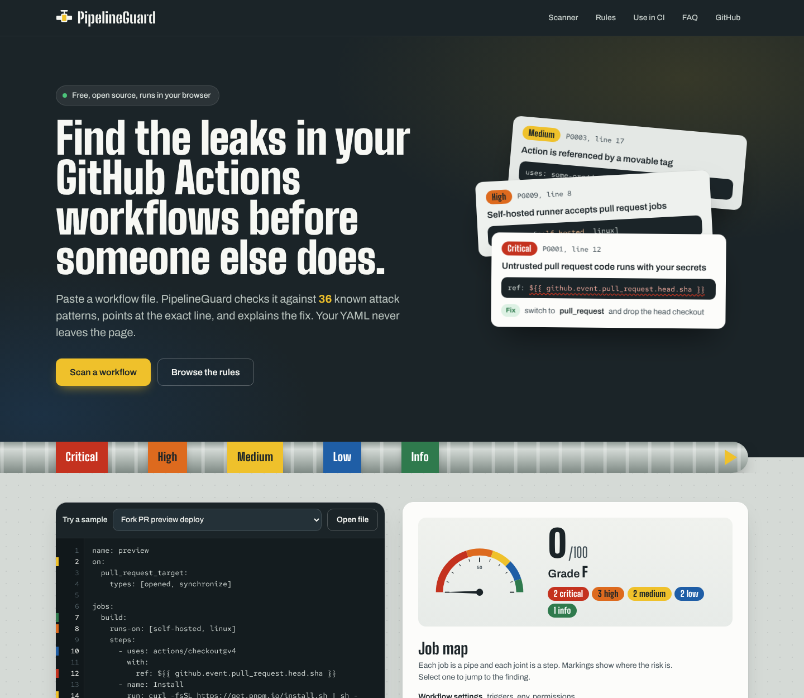

# PipelineGuard: GitHub Actions security scanner

[](https://github.com/yousafkhamza/pipelineguard/actions/workflows/pages.yml)
[](https://github.com/yousafkhamza/pipelineguard/actions/workflows/ci.yml)
[](LICENSE)

**Live demo: https://yousafkhamza.github.io/pipelineguard/**

Paste a GitHub Actions workflow and PipelineGuard shows which line an attacker could use, how bad it is, and how to fix it. The scan runs entirely in your browser. You can optionally have an AI model (Claude or OpenAI, using your own key) draft the corrected YAML.

The same engine ships as a **Node CLI** and a **GitHub Action**, with SARIF output for GitHub code scanning.



## What it catches

| Rule | What it catches | Default severity |
| --- | --- | --- |
| [PG001](https://yousafkhamza.github.io/pipelineguard/rules/#pwn-request-checkout) | Untrusted pull request code runs with a privileged token | Critical |
| [PG002](https://yousafkhamza.github.io/pipelineguard/rules/#script-injection) | Attacker-controlled text is pasted straight into a shell script | High |
| [PG003](https://yousafkhamza.github.io/pipelineguard/rules/#unpinned-action) | Action is referenced by a movable tag or branch | Medium |
| [PG004](https://yousafkhamza.github.io/pipelineguard/rules/#broad-token-permissions) | GITHUB_TOKEN permissions are not restricted | Medium |
| [PG005](https://yousafkhamza.github.io/pipelineguard/rules/#secret-in-script) | Secret is interpolated directly into a run script | Medium |
| [PG006](https://yousafkhamza.github.io/pipelineguard/rules/#hardcoded-credential) | Credential is committed in the workflow file | Critical |
| [PG007](https://yousafkhamza.github.io/pipelineguard/rules/#curl-pipe-shell) | Remote script is piped straight into a shell | Medium |
| [PG008](https://yousafkhamza.github.io/pipelineguard/rules/#unsecure-commands) | Deprecated set-env / add-path commands are re-enabled | High |
| [PG009](https://yousafkhamza.github.io/pipelineguard/rules/#self-hosted-on-pr) | Self-hosted runner accepts pull request jobs | High |
| [PG010](https://yousafkhamza.github.io/pipelineguard/rules/#checkout-persists-credentials) | actions/checkout leaves the token in .git/config | Low |
| [PG011](https://yousafkhamza.github.io/pipelineguard/rules/#unpinned-container-image) | Container image is not pinned to a digest | Low |
| [PG012](https://yousafkhamza.github.io/pipelineguard/rules/#artifact-poisoning) | Privileged workflow trusts artifacts from an untrusted run | High |
| [PG013](https://yousafkhamza.github.io/pipelineguard/rules/#missing-timeout) | Job has no timeout | Info |
| [PG014](https://yousafkhamza.github.io/pipelineguard/rules/#secrets-inherit) | Reusable workflow receives every secret | Low |
| [PG015](https://yousafkhamza.github.io/pipelineguard/rules/#unguarded-comment-trigger) | Anyone can trigger this job by commenting | Medium |
| [PG016](https://yousafkhamza.github.io/pipelineguard/rules/#privileged-trigger) | Privileged trigger without explicit permissions | Medium |
| [PG017](https://yousafkhamza.github.io/pipelineguard/rules/#dispatch-input-injection) | Manual workflow input is pasted into a shell script | Medium |
| [PG018](https://yousafkhamza.github.io/pipelineguard/rules/#step-output-injection) | Step or job output is pasted into a shell script | Low |
| [PG019](https://yousafkhamza.github.io/pipelineguard/rules/#always-true-if) | if: condition is always true | High |
| [PG020](https://yousafkhamza.github.io/pipelineguard/rules/#literal-credential-input) | Password or token is passed as plain text to an action | High |
| [PG021](https://yousafkhamza.github.io/pipelineguard/rules/#github-token-in-script) | GITHUB_TOKEN is written into a run script | Medium |
| [PG022](https://yousafkhamza.github.io/pipelineguard/rules/#tls-verification-disabled) | TLS certificate checks are turned off | Medium |
| [PG023](https://yousafkhamza.github.io/pipelineguard/rules/#trace-with-secrets) | Shell tracing is on in a step that has secrets | Medium |
| [PG024](https://yousafkhamza.github.io/pipelineguard/rules/#artifact-uploads-workspace) | Whole workspace is uploaded as an artifact | Medium |
| [PG025](https://yousafkhamza.github.io/pipelineguard/rules/#cache-in-privileged-workflow) | Cache is used in a privileged workflow | Medium |
| [PG026](https://yousafkhamza.github.io/pipelineguard/rules/#deprecated-workflow-command) | Uses the removed set-output / save-state commands | Low |
| [PG027](https://yousafkhamza.github.io/pipelineguard/rules/#archived-action) | Action is archived and no longer maintained | Low |
| [PG028](https://yousafkhamza.github.io/pipelineguard/rules/#retired-runner-image) | Job targets a retired runner image | Low |
| [PG029](https://yousafkhamza.github.io/pipelineguard/rules/#previously-compromised-action) | Action had a publicly reported compromise | Medium |
| [PG030](https://yousafkhamza.github.io/pipelineguard/rules/#typosquatted-action) | Action name looks like a typo of a popular action | High |
| [PG031](https://yousafkhamza.github.io/pipelineguard/rules/#privileged-container) | Container runs with --privileged or the Docker socket | Medium |
| [PG032](https://yousafkhamza.github.io/pipelineguard/rules/#unlocked-dependency-install) | Dependencies are installed without the lockfile | Low |
| [PG033](https://yousafkhamza.github.io/pipelineguard/rules/#broad-oidc-permission) | OIDC id-token: write is granted to the whole workflow | Low |
| [PG034](https://yousafkhamza.github.io/pipelineguard/rules/#deploy-without-concurrency) | Deploy workflow can run twice at the same time | Info |
| [PG035](https://yousafkhamza.github.io/pipelineguard/rules/#workflow-run-any-branch) | workflow_run trigger has no branch filter | Low |
| [PG036](https://yousafkhamza.github.io/pipelineguard/rules/#unchecked-failure) | Security or test step is allowed to fail silently | Low |

Each rule has a write-up with a vulnerable and a fixed example: [rule reference](https://yousafkhamza.github.io/pipelineguard/rules/).

## Use it in CI

```yaml
name: workflow security
on:
  pull_request:
    paths: [".github/workflows/**"]
  push:
    branches: [main]

permissions:
  contents: read
  security-events: write

jobs:
  pipelineguard:
    runs-on: ubuntu-latest
    timeout-minutes: 5
    steps:
      - uses: actions/checkout@3d3c42e5aac5ba805825da76410c181273ba90b1 # v7.0.1
        with:
          persist-credentials: false
      - uses: yousafkhamza/pipelineguard@v1 # pin to a release SHA
        with:
          path: .github/workflows   # files or folders, space-separated
          fail-on: high             # critical | high | medium | low | info | none
          sarif: pipelineguard.sarif
      - uses: github/codeql-action/upload-sarif@33d7b85da1a04171e211befe2c739303b9a4c066 # v4.39.3
        if: always()
        with:
          sarif_file: pipelineguard.sarif
```

## Use it from a terminal

Requires Node.js 20 or newer. There are no dependencies to install.

```bash
npx github:yousafkhamza/pipelineguard .github/workflows

# or from a clone
node cli/pipelineguard.mjs .github/workflows --fail-on high
node cli/pipelineguard.mjs .github/workflows --format sarif --output report.sarif
node cli/pipelineguard.mjs ci.yml deploy.yml --format json
```

| Option | Default | Meaning |
| --- | --- | --- |
| `--format` | `text` | `text`, `json` or `sarif` |
| `--fail-on` | `high` | Exit 1 when a finding is at or above this severity; `none` never fails |
| `--output` | stdout | Write the report to a file |

Exit codes: `0` clean, `1` findings at or above the threshold (or a file that isn't valid YAML), `2` bad arguments.

## How the AI fix works

The AI fix is optional. **Draft fixes with AI** sends the workflow and the findings straight from your browser to Anthropic or OpenAI with a key you paste in. The key stays in memory for that tab and is never saved or sent anywhere else. If you don't want to use a key, **Copy AI prompt** gives you the same prompt to paste into any assistant.

## Project layout

```
site/                  GitHub Pages site (published as-is)
  engine/              scan engine, shared by the browser, CLI and Action
    rules.mjs          rule catalogue: text, severity, examples
    scan.mjs           detection logic and scoring
    samples.mjs        demo workflows
    js-yaml.mjs        vendored YAML parser (MIT)
  assets/              CSS, JS, self-hosted fonts
  rules/index.html     generated rule reference (SEO page)
cli/pipelineguard.mjs  command-line interface
action.yml             composite GitHub Action
scripts/build.mjs      generates the rules page, index table and sitemap
scripts/serve.mjs      local preview at http://localhost:8080/pipelineguard/
tests/                 node:test suite
```

## Develop

```bash
npm test             # run the engine tests
npm run build        # regenerate rules page + sitemap after editing rules.mjs
npm run serve        # preview locally
npm run scan         # scan this repo's own workflows
```

To add a rule, add its metadata to `site/engine/rules.mjs`, add the detection to `site/engine/scan.mjs`, add a test, then run `npm run build`.

## Deploying your own copy

1. Push to GitHub.
2. Go to **Settings > Pages > Build and deployment** and set **Source** to **GitHub Actions**.
3. Push to `main`. The `pages` workflow tests the engine, regenerates the SEO pages, scans its own workflows, and deploys `site/`.

If you fork under a different name, replace `yousafkhamza.github.io/pipelineguard` in `site/index.html`, `scripts/build.mjs`, `site/robots.txt` and `cli/pipelineguard.mjs`.

## Limits

PipelineGuard is a static check. It can't see what a third-party action does internally, your repository or org settings, or branch protection. Treat a clean result as a first review, not a sign-off.

## Author

Built by **Yousaf Hamza** (Yousaf K Hamza), a Senior DevOps and Platform Engineer in Dubai. Find more of my work at [yousafkhamza.github.io](https://yousafkhamza.github.io/) and on [GitHub](https://github.com/yousafkhamza).

MIT licensed.
